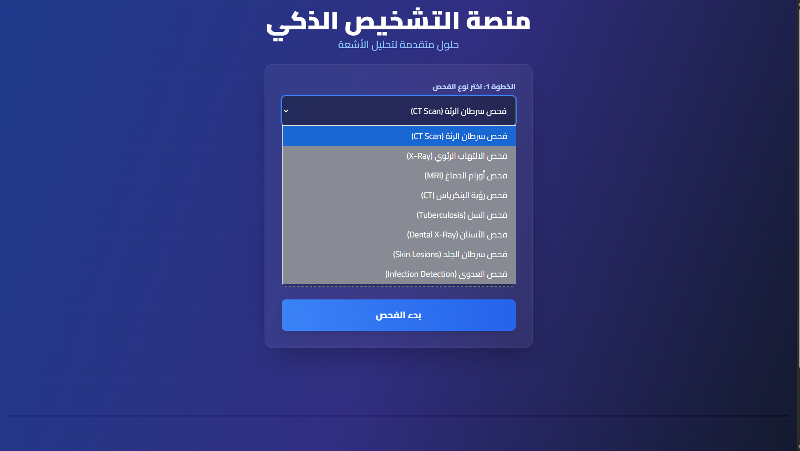
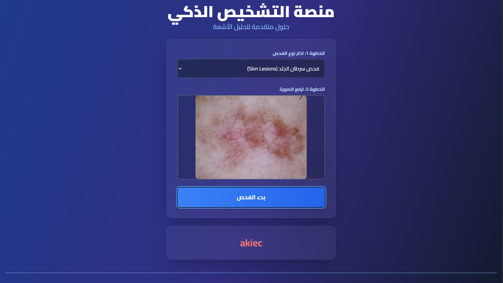

# 🩺 Doctor AI

### Intelligent Medical Decision Support Prototype
### نظام ذكي لدعم التشخيص الطبي

**Python · Flask · TensorFlow · Tailwind CSS · JavaScript**

🏆 **Finalist — Jordan Students Pitch Competition 2025 (JSPC)**  
*Queen Rania Center for Entrepreneurship (QRCE)*

---

## 📖 Overview | نبذة عن المشروع

**Doctor AI** is an AI-powered medical decision support prototype designed to explore how deep learning and Explainable AI (XAI) can assist healthcare professionals in interpreting medical information.

The platform integrates multiple machine learning models through a Python Flask backend and provides a web interface for submitting inputs, requesting predictions, and viewing results.

The project was presented at the **Jordan Students Pitch Competition 2025 (JSPC)**, where our team reached the finalist stage.

> **Disclaimer:** Doctor AI is an academic prototype developed for educational and research purposes. It is not a clinically validated medical device and should not be used for actual medical diagnosis or treatment decisions.

---

## 🧠 AI Models & Supported Conditions

The project brings together eight specialized models covering medical imaging and other health-related prediction tasks.

| Condition | Model Architecture | Reported Accuracy |
|---|---|---|
| Brain Tumor Detection | CNN / ResNet | 98.4% |
| Pneumonia (X-Ray) | VGG16 | 96.2% |
| Skin Cancer (Melanoma) | EfficientNet | 95.8% |
| Diabetic Retinopathy | Custom CNN | 97.1% |
| Alzheimer's MRI | DenseNet | 94.5% |
| Breast Cancer | ResNet50 | 96.0% |
| Heart Disease | ANN | 95.5% |
| Kidney Stone | CNN | 95.0% |

*The figures above are project-reported model evaluation results, not measures of clinical diagnostic performance. The underlying evaluation datasets and methodology should be consulted before comparing model accuracy.*

---

## 📸 Project Screenshots

### Home Page

### Prediction Results

---

## ⚙️ Technical Overview

Doctor AI connects a browser-based frontend with Python backend services and machine learning models.

The backend provides the communication layer between the web interface and the AI components developed by the project team.

### Backend — Python & Flask

The backend is responsible for:

- Exposing RESTful endpoints for prediction requests.
- Receiving and validating user-submitted inputs.
- Handling medical image uploads for supported prediction tasks.
- Connecting requests to the appropriate AI model interfaces.
- Processing model responses and returning structured results.
- Supporting communication between the frontend and AI components.

### Frontend

The web interface was developed using:

- HTML
- Tailwind CSS
- JavaScript
- AJAX

It allows users to interact with the prototype, submit inputs, and view the results returned by the backend.

### AI Integration

The AI models are integrated with the application through Flask-based services.

This separation allows the web interface to communicate with the prediction functionality through defined API endpoints.

---

## 🚀 Key Features

- **Multiple Prediction Pathways:** Integration of eight AI models for different medical prediction tasks.
- **RESTful API Integration:** Flask endpoints connecting the web interface with AI components.
- **Medical Image Uploads:** Input handling for supported image-based prediction tasks.
- **Prediction Results:** Structured responses displayed through the web interface.
- **Explainable AI:** Exploration of interpretable AI outputs to support understanding of model predictions.
- **Responsive Interface:** Web interface developed using Tailwind CSS and JavaScript.

---

## 👨‍💻 My Contributions

**Abdalrhman Hamed — Backend Development & AI Integration**

My work focused on building the application backend and connecting the AI components with the web interface.

Key contributions:

- Developed backend services and RESTful APIs using Python and Flask.
- Integrated AI models developed by other team members with the application backend.
- Implemented request handling, input validation, and medical image upload functionality.
- Connected frontend interactions with Flask endpoints using JavaScript and AJAX.
- Contributed to developing the responsive web interface using Tailwind CSS.
- Worked on integrating the different components into a functional prototype.

**AI model development and training were handled by other members of the project team.**

---

## 🛠️ Technology Stack

| Area | Technologies |
|---|---|
| Backend | Python, Flask |
| AI / Machine Learning | TensorFlow, Deep Learning Models |
| Frontend | HTML, Tailwind CSS, JavaScript |
| API Integration | RESTful APIs, AJAX |
| Project Type | Academic AI Prototype |

---

## 🏆 Competition

**Jordan Students Pitch Competition 2025 (JSPC)**  
**Achievement:** Finalist  
**Organizer:** Queen Rania Center for Entrepreneurship (QRCE)

The competition provided an opportunity to present the Doctor AI concept and demonstrate how software engineering and artificial intelligence can be combined in healthcare-related applications.

---

## 📬 Contact

**Abdalrhman Hamed**

[LinkedIn](https://www.linkedin.com/in/abdalrhman-hamed-5b929725b/) · [GitHub](https://github.com/abood3omar)

---

*Doctor AI — Exploring the intersection of software engineering, artificial intelligence, and healthcare.*
